# FLOP Testnet Validator Preparation Guide

**English** | [Türkçe](Turkce-Kurulum.md)

FLOP opened registration for the first 50 testnet validator seats. FLOP asks candidates for two
things: register the team, and rehearse on a keyless Devnet node on a server without a GPU. This guide
walks through both.

> [!WARNING]
> Registering does not guarantee a seat; seat assignment, sponsorship and activation are separate
> steps. Validator keys and the ceremony packet come when FLOP freezes the runtime, and this guide will
> be updated then. Test FLOP has no monetary value.

Every step was run end to end on a rented Ubuntu 22.04 server on 24 November 2026.

---

## Requirements

| Part | Testnet validator (FLOP reference) | Enough for the rehearsal |
| --- | --- | --- |
| CPU | 8 physical cores, 3.4 GHz or faster | 4 vCPU |
| RAM | 32 GB ECC (64 GB recommended) | 16 GB |
| Disk | 4 TB enterprise NVMe | 300 GB SSD |
| Network | 1 Gbps symmetric | Stable IPv4, open TCP 30333 |
| GPU | Not needed | Not needed |

- Rehearse on the server that will run the validator.

---

## 1. Register Your Team

Form: https://github.com/flop-labs/network/issues/new?template=operator-application.yml

- Choose `testnet` under **Network** and `validator candidate` under **Requested role**.
- Give your team name, planned host count, provider and region. You can register before the host
  is ready.
- One issue per team, submitted from GitHub's web page. The issue is public: never post a seed, key
  or password.

Example application:

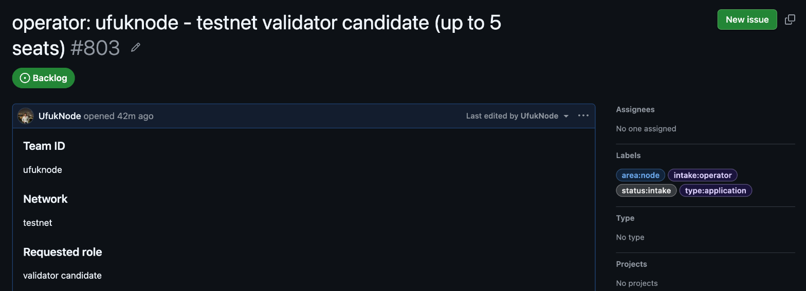

---

## 2. Connect to the Server

```bash
ssh root@SERVER_IP
```

- Replace `SERVER_IP` with your server's IP. With another SSH port: `ssh -p PORT root@SERVER_IP`

Example output:

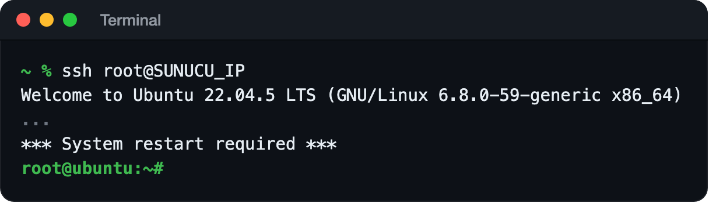

---

## 3. Tools

```bash
apt-get update && apt-get install -y curl jq zstd
```

Example output:

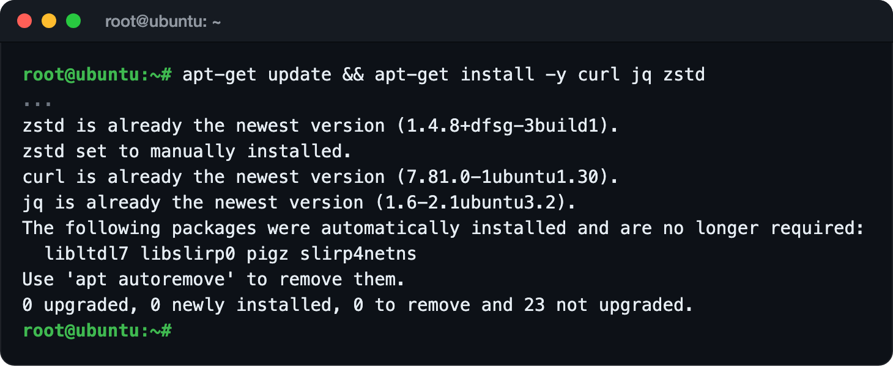

---

## 4. Install Docker

```bash
curl -fsSL https://get.docker.com | sh
```

```bash
docker --version && docker compose version
```

- Skip the first command if Docker is already installed.

Example output:

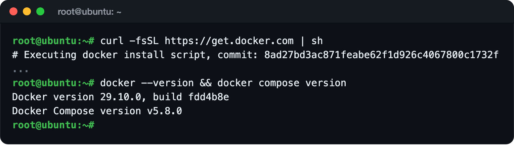

---

## 5. Download FLOP's Files

```bash
mkdir -p ~/flop-devnet-rpc && cd ~/flop-devnet-rpc
files=https://gist.githubusercontent.com/sv/7c8b93f3868bc15e3b6eabe0578057e3/raw/21adaa99c601003278d1682bf937696f21d31432
for file in docker-compose.rpc.yml node-entrypoint.sh rpc_ready.py rpc-pool.env.example rpc-origin.Caddyfile; do
  curl -fsSL -o "$file" "$files/$file"
done
sha256sum --check <<'SUMS'
6487cd84d5a257659297ad7b8fdd55978e6d8327bfe029d9460645da2591345d  docker-compose.rpc.yml
7279e81c0d6de4b6c59733b64132f929b8b7dd5825b8f37433d09940a93f983d  node-entrypoint.sh
6a066b7540628c7db4f455d7bfd2540db54355a4c0a2959d97032b76bcf641cd  rpc_ready.py
4f7295735f75b5a7b4c0babe3be4b0eef687decab99ba1612f91ee6f3b04d1bb  rpc-pool.env.example
e184d4f38f054dbe7947efde4d85e6a8964f02e594666ad42b9216dd98a4b2d5  rpc-origin.Caddyfile
SUMS
```

- All five files must say `OK`. They come from FLOP's
  [own guide](https://gist.github.com/sv/7c8b93f3868bc15e3b6eabe0578057e3).

Example output:

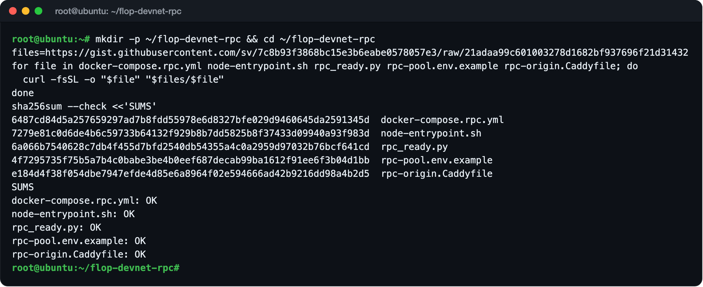

---

## 6. Download the Chain Spec

```bash
curl -fsSL -o chain.raw.json https://explorer.devnet.flop.network/validator-downloads/flop_devnet_ts-99c172c095340ace.raw.json
echo "3b213c38e7678285bc38fbdfded5dbe3d6acbd16e836b14aaaeef2f6ae1cd16e  chain.raw.json" | sha256sum --check
cp -n rpc-pool.env.example rpc-pool.env
```

Example output:

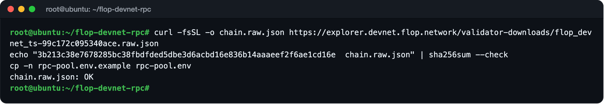

---

## 7. Settings

```bash
P2P_PORT_DIS=30333
sed -i "s#^HOST_IP=.*#HOST_IP=$(ip -4 route get 1.1.1.1 | awk '{print $7}')#" rpc-pool.env
sed -i "s#^PUBLIC_ADDR=.*#PUBLIC_ADDR=/ip4/$(curl -4fsS https://ifconfig.me)/tcp/$P2P_PORT_DIS#" rpc-pool.env
grep -E '^(HOST_IP|RPC_BIND_IP|PROMETHEUS_BIND_IP|STATE_PRUNING)=' rpc-pool.env
```

- Open inbound TCP 30333 in your provider's panel. If the provider forwards it under another number,
  put that number in the first line (32014 on the server in the picture).
- `RPC_BIND_IP` and `PROMETHEUS_BIND_IP` must stay `127.0.0.1`.

Example output:

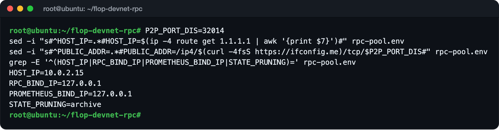

---

## 8. Start the Node

```bash
dc() { docker compose --env-file ~/flop-devnet-rpc/rpc-pool.env -f ~/flop-devnet-rpc/docker-compose.rpc.yml "$@"; }
dc config --quiet && dc up -d
```

```bash
dc logs --tail=40 rpc | grep -E "Syncing|Imported|finalized" | tail -4
curl -s -o /dev/null -w '%{http_code}\n' http://127.0.0.1:9619/ready
```

- `503` is normal: the node is syncing. Paste the `dc` line again whenever you reconnect.

Example output:

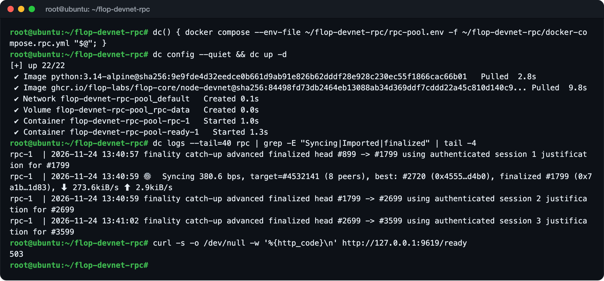

---

## 9. Download FLOP's Daily Snapshot

A sync from genesis takes about 3 hours. FLOP's daily snapshot cuts it to minutes.

```bash
mkdir -p ~/flop-devnet-rpc/seed && cd ~/flop-devnet-rpc/seed
BASE=https://snapshots.flop.network/devnet-ts/archive
curl -fsS -o latest.json "$BASE/latest.json"
jq -r '.name, .genesis_hash' latest.json
jq -r '.parts[] | "\(.sha256)  \(.file)"' latest.json > SHA256SUMS
jq -r '.parts[] | .file' latest.json | while read -r f; do curl -fsS -C - -o "$f" "$BASE/$(jq -r .name latest.json)/$f"; done
sha256sum --check SHA256SUMS
mkdir -p unpack && jq -r '.parts[].file' latest.json | xargs cat | zstd -d | tar -x -C unpack && ls unpack
```

- The snapshot is about 42 GB. Keep at least 120 GB free.
- If it stops, paste the same block again: it resumes.

Example output:

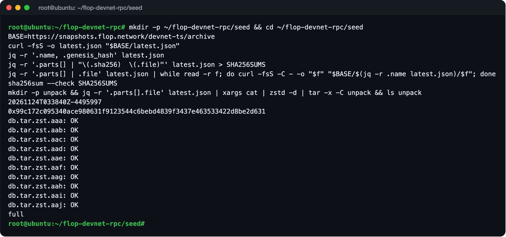

---

## 10. Load the Snapshot

```bash
cd ~/flop-devnet-rpc && dc stop
db="$(docker volume inspect -f '{{.Mountpoint}}' flop-devnet-rpc-pool_rpc-data)/chains/flop_devnet_ts/db"
mv "$db/full" "$db/full.from-genesis" && mv seed/unpack/full "$db/full" && chown -R --reference="$db" "$db/full"
dc up -d
```

```bash
until curl -fs -o /dev/null http://127.0.0.1:9619/ready; do sleep 5; done; echo ready
```

- `ready` means the node caught up.
- Then free the space: `rm -rf ~/flop-devnet-rpc/seed "$db/full.from-genesis"`

Example output:

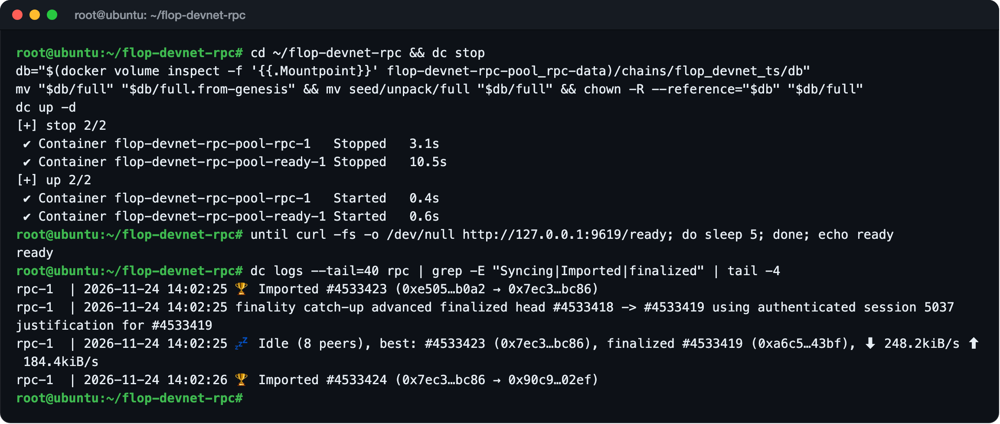

---

## 11. Check

```bash
rpc() { curl -fsS --max-time 15 "$1" -H 'Content-Type: application/json' --data "{\"jsonrpc\":\"2.0\",\"id\":1,\"method\":\"$2\",\"params\":$3}" | jq -er .result; }
fin() { printf '%d' "$(rpc "$1" chain_getHeader "[\"$(rpc "$1" chain_getFinalizedHead '[]')\"]" | jq -r .number)"; }
observe() {
  L=http://127.0.0.1:9944/; R=https://rpc.devnet.flop.network/
  lh=$(fin $L); rh=$(fin $R); ch=$(( lh < rh ? lh : rh ))
  [ "$(rpc $L chain_getBlockHash '[0]')" = "$(rpc $R chain_getBlockHash '[0]')" ] || { echo "GENESIS MISMATCH"; return 1; }
  lhash=$(rpc $L chain_getBlockHash "[$ch]"); rhash=$(rpc $R chain_getBlockHash "[$ch]")
  [ "$lhash" = "$rhash" ] && ok=MATCH || ok=MISMATCH
  echo "UTC=$(date -u +%FT%TZ) local=$lh reference=$rh common=$ch $ok hash=$lhash peer=$(rpc $L system_localPeerId '[]')"
}
```

```bash
observe
sleep 60; observe
dc restart rpc ready
until curl -fs -o /dev/null http://127.0.0.1:9619/ready; do sleep 5; done; observe
```

- All three lines must say `MATCH` and `peer=` must not change. This is the rehearsal FLOP asks for:
  your node follows the chain correctly and keeps its identity across a restart.

Example output:

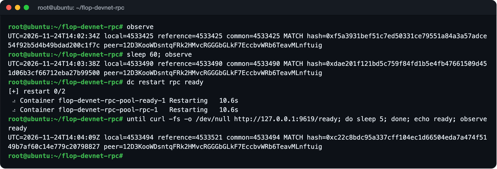

---

## 12. Backup

The node identity is one file. Pull it to your own computer:

```bash
mkdir -p ~/flop-validator-backup
scp root@SERVER_IP:/var/lib/docker/volumes/flop-devnet-rpc-pool_rpc-data/_data/node_key.dat ~/flop-validator-backup/
scp root@SERVER_IP:flop-devnet-rpc/rpc-pool.env ~/flop-validator-backup/
```

- To move servers, run steps 2-7 on the new one, copy `node_key.dat` to its home folder and run this
  instead of step 8; the peer ID stays the same:

```bash
dc() { docker compose --env-file ~/flop-devnet-rpc/rpc-pool.env -f ~/flop-devnet-rpc/docker-compose.rpc.yml "$@"; }
dc up -d && sleep 10 && dc stop
V=$(docker volume inspect -f '{{.Mountpoint}}' flop-devnet-rpc-pool_rpc-data)
install -o "$(stat -c %u $V/node_key.dat)" -g "$(stat -c %g $V/node_key.dat)" -m 644 ~/node_key.dat $V/node_key.dat
dc up -d
```

- Never share `node_key.dat`.

---

Prepared by [@UfukDegen](https://x.com/UfukDegen)
