# FLOP Validator Preparation and Application Guide (Devnet)

**English** | [Türkçe](Turkce-Kurulum.md)

> [!WARNING]
> **Read this first (8 November 2026):** this guide does not make you a validator. It gets you
> ready to apply. On devnet the FLOP team admits validators one by one, and it does not take
> applications right away. On 7 November FLOP wrote that it
> ["will be expanding cap slowly"](https://x.com/flop_labs/status/2119121264388526205). Today only
> FLOP's own 10 validators are running, and the one new sponsored validator has been waiting in
> the queue since 6 November. More than 30 people have posted their details in the application
> thread on GitHub, and FLOP has not answered any of them yet. Do not rent a big server before
> you are admitted.

This guide is for anyone who wants to prepare a server from scratch and apply to run a validator
on the FLOP Devnet.

A validator is the machine that produces blocks on the FLOP network, votes to finalize them and
stores the network's data. Unlike a miner, it needs no GPU.

The guide has three parts:

- **Preparation (steps 1-13):** connecting to the server, the required programs, the package
  checks, creating the validator account and the details you send to FLOP. We tested every one
  of these steps ourselves on a freshly installed server. Each step shows its real output.
- **Application (step 14):** the interest form and the application thread on GitHub.
- **After admission (steps 15-17):** joining FLOP's private network, registering and becoming
  active. These steps need FLOP's approval, so they have not been tested yet. They are
  summarized from FLOP's own documentation.

If you have a GPU, you can also run a miner, which needs no approval:
[FLOP GPU Miner Setup Guide](https://github.com/UfukNode/flop-miner-setup)

> [!IMPORTANT]
> The devnet is a test network. It gives no rewards and no airdrop points, and it can be reset.
> There is no FLOP token yet: anything that says "buy", "claim" or "mint" is a scam. FLOP has no
> official Discord or Telegram. Anyone who tries to sell you an "approval" or a "whitelist" spot
> is a scammer. All official links are on https://flop.finance/official/.

---

## General Information

| Item | Value |
| --- | --- |
| Network | FLOP Devnet |
| Role | Validator |
| GPU | Not needed |
| Package | `validator-cs-be91fe83`, version `0.3.0-devnet.1` |
| Admission | Approved by hand by the FLOP team |
| Stake | Registration locks 1,200,000 devnet FLOP. On devnet the FLOP team funds it |
| Rewards | None (devnet) |
| Official validator docs | https://docs.flop.network/docs/run-validator |
| Explorer | https://explorer.devnet.flop.network/validator |

---

## System Requirements

| Part | FLOP's recommendation |
| --- | --- |
| CPU | 8 dedicated cores |
| RAM | 32 GB. The testnet page recommends 64 GB |
| Disk | 4 TB NVMe. The testnet page says 2 TB at least |
| Network | 1 Gbps, reliable |
| Operating system | Linux amd64 (Ubuntu 22.04 or 24.04) |

FLOP says these values are planning estimates, not measured devnet minimums.

The preparation steps also run on a much smaller machine. We tested them on a server with 11
cores, 12 GB of RAM and a 126 GB disk. But the enrollment key FLOP sends after admission is
encrypted to the SSH key of the server whose details you sent, and it only opens on that server.
So do the preparation on the server that will really run your validator.

> [!TIP]
> If you do not have a server yet, only fill in the interest form in step 14 for now. Rent the
> server when you hear back from FLOP.

---

## 1. Connect to the Server

Connect to your server from your own computer's terminal:

```bash
ssh root@SERVER_IP
```

- Replace `SERVER_IP` with your server's IP address. If your server uses a different SSH port,
  the command is `ssh -p PORT root@SERVER_IP`.
- On the first connection you see `Are you sure you want to continue connecting
  (yes/no/[fingerprint])?`. Type `yes` and press Enter.
- On Windows, follow my WSL setup guide first:
  https://x.com/UfukDegen/status/1944066889346429338
- Every command from here on runs on the server as `root`. If you logged in as a normal user,
  type `sudo -i` first.

Example output:

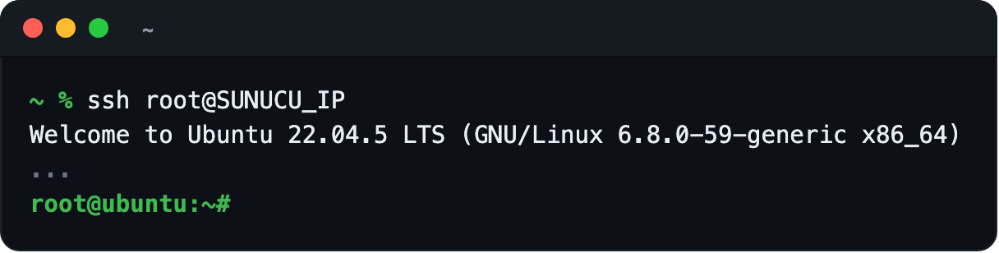

---

## 2. Update the System and Install the Basic Packages

```bash
apt update && apt upgrade -y
```

```bash
apt install -y curl jq age xz-utils
```

- The update can take a few minutes.
- If a purple window asks which services to restart, press Enter.
- If the update also installs a new kernel, you see `*** System restart required ***` at your
  next login. The preparation steps do not need a restart. If you want one, type `reboot` and
  connect again after a few minutes.

Example output:

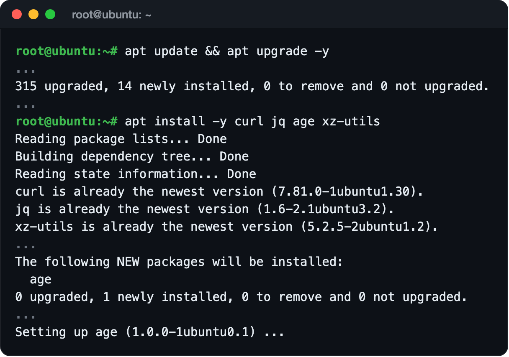

---

## 3. Name the Server

FLOP adds your server to its private network under this name. Do not change it after you send
it to FLOP.

```bash
hostnamectl set-hostname your-validator-name
hostname
```

- Replace `your-validator-name` with a unique name made of lowercase letters, digits and
  hyphens.
- The last command should print the new name.

Example output:

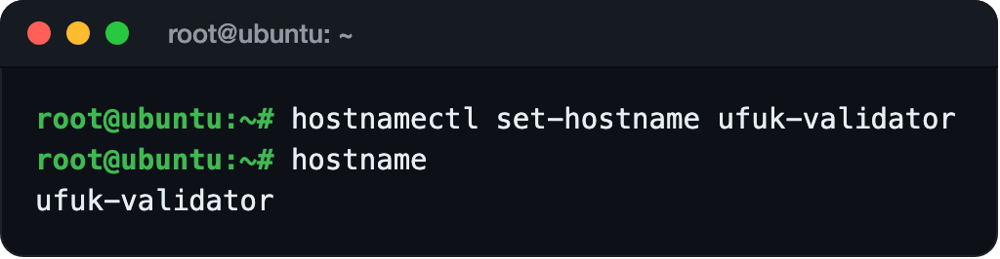

---

## 4. Install Docker

Most new servers come without Docker. Install it with Docker's official script:

```bash
curl -fsSL https://get.docker.com | sh
```

Check the installation:

```bash
docker --version && docker compose version
```

You should see two version numbers. If Docker is already installed on your server, skip the
install command and only run the check.

Example output:

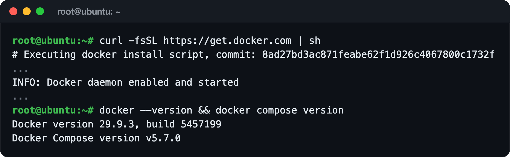

---

## 5. Install Node.js 24 and pnpm

The download is checked against Node.js's own checksum list:

```bash
cd /tmp
SUMS=$(curl -fsSL https://nodejs.org/dist/latest-v24.x/SHASUMS256.txt)
NODE_TGZ=$(echo "$SUMS" | awk '/linux-x64\.tar\.xz$/{print $2}')
curl -fsSLO "https://nodejs.org/dist/latest-v24.x/$NODE_TGZ"
echo "$SUMS" | grep " $NODE_TGZ\$" | sha256sum -c -
tar -xJf "$NODE_TGZ" -C /usr/local --strip-components=1
node -v
corepack enable
```

You should see a `...linux-x64.tar.xz: OK` line and a version that starts with `v24`. `corepack`
downloads the pnpm version the package asks for (12.14.0) the first time you use it.

Example output:

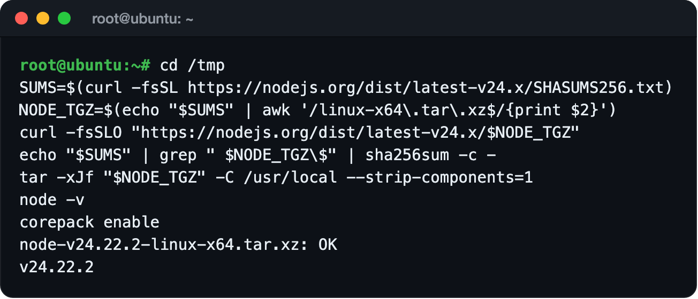

---

## 6. Install Tailscale

Tailscale is installed, but you do not log in:

```bash
. /etc/os-release
curl -fsSL "https://pkgs.tailscale.com/stable/ubuntu/$VERSION_CODENAME.noarmor.gpg" -o /usr/share/keyrings/tailscale-archive-keyring.gpg
curl -fsSL "https://pkgs.tailscale.com/stable/ubuntu/$VERSION_CODENAME.tailscale-keyring.list" -o /etc/apt/sources.list.d/tailscale.list
apt update && apt install -y tailscale
tailscale status
```

The last command should print `Logged out.`

Example output:

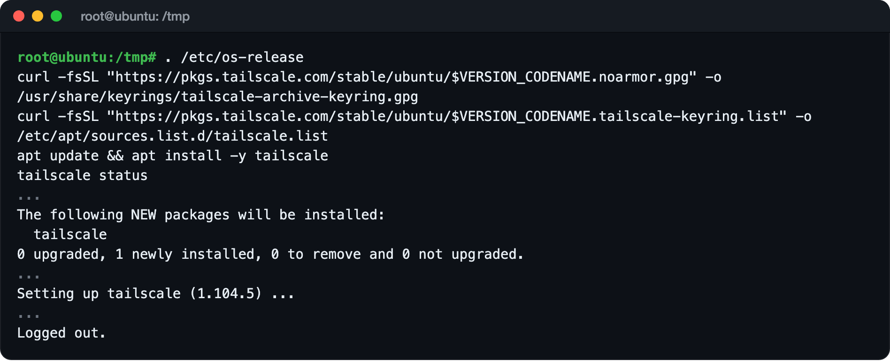

> [!CAUTION]
> Do not run `tailscale up` or `tailscale login`. Your server joins FLOP's private network with
> the single-use key FLOP sends after admission.

---

## 7. Install cosign

We use this tool in step 9 to check the signatures of FLOP's Docker images:

```bash
cd /tmp
curl -fsSLO https://github.com/sigstore/cosign/releases/download/v3.1.4/cosign-linux-amd64
curl -fsSL https://github.com/sigstore/cosign/releases/download/v3.1.4/cosign_checksums.txt | grep ' cosign-linux-amd64$' | sha256sum -c -
install -m 755 cosign-linux-amd64 /usr/local/bin/cosign
```

You should see `cosign-linux-amd64: OK`.

Example output:

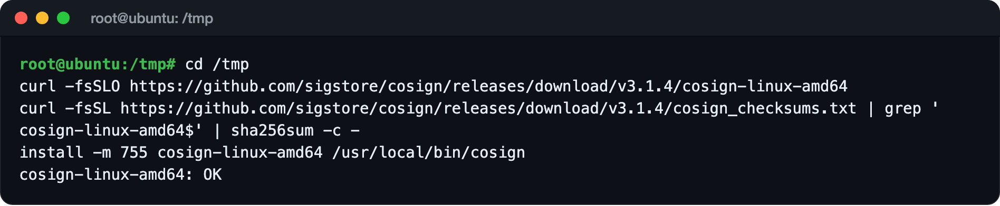

---

## 8. Download and Check the Package

```bash
mkdir -p /opt/flop-validator && cd /opt/flop-validator
curl -fsSLO https://explorer.devnet.flop.network/validator-downloads/validator-cs-be91fe83-0.3.0-devnet.1.tar.gz
echo "bf98e281b7d3217fb52e9aeba75886d2165e66d32f0159dbc3f1f2e998e30ba7  validator-cs-be91fe83-0.3.0-devnet.1.tar.gz" | sha256sum -c -
tar -xzf validator-cs-be91fe83-0.3.0-devnet.1.tar.gz
cd validator-cs-be91fe83
sha256sum -c SHA256SUMS | grep -c ': OK$'
node preflight.mjs
```

- The long value is the package checksum published in FLOP's validator docs.
- You should see `OK`, then `26` (all 26 files are correct), then `verified` on the last line.
- Your `finalized` and `peers` numbers will differ.

Example output:

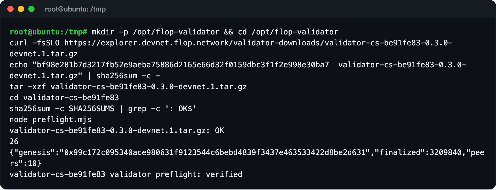

> [!NOTE]
> The old `0.2.0-devnet.1` link on the explorer does not work (404). The current package is
> `0.3.0-devnet.1`.

---

## 9. Check the Signatures

This checks that the two Docker images the package uses were really built in FLOP's GitHub:

```bash
WF=https://github.com/flop-labs/flop-core/.github/workflows/build-services.yml@refs/heads/main
for IMG in \
  ghcr.io/flop-labs/flop-core/node-devnet@sha256:84498fd73db2464eb13088ab34d369ddf7cddd22a45c810d140c9ff8ec16c91d \
  ghcr.io/flop-labs/flop-core/da-validator@sha256:c6709bb5bba04978a7800daccd87bb2bf916edd34d7dbf09f84aba5be9aca949; do
  if cosign verify "$IMG" --certificate-oidc-issuer https://token.actions.githubusercontent.com --certificate-identity "$WF" >/dev/null 2>&1; then echo "OK: ${IMG%%@*}"; else echo "FAILED: ${IMG%%@*}"; fi
done
```

Both lines should say `OK`. If you see `FAILED`, stop.

Example output:

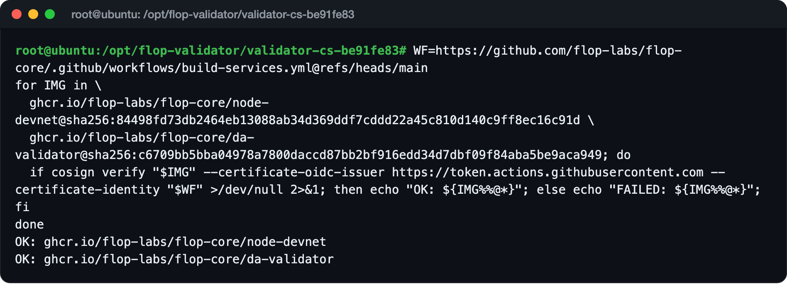

---

## 10. Install the Dependencies

```bash
cd /opt/flop-validator/validator-cs-be91fe83
export COREPACK_ENABLE_DOWNLOAD_PROMPT=0
pnpm --version
pnpm install --frozen-lockfile --ignore-scripts
```

You should see `12.14.0` and a `Done in ...` line at the end. If you see `Update available!`, do
not update pnpm. The package is made to run with version 12.14.0.

Example output:

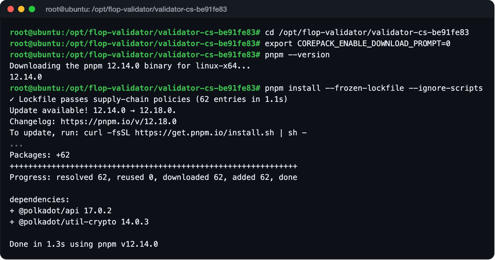

---

## 11. Create the Validator Account

```bash
pnpm onboard prepare
```

This downloads FLOP's node image (233 MB) and creates your validator account.

- `Hostname` is the name you set in step 3.
- `Public SS58 address` is your validator account's address and starts with `5`. It is not a
  secret.
- The command says "two public values", but FLOP's current docs ask for three, including the SSH
  key from step 13.

Check the two files the command created:

```bash
ls -la account.json .env
```

Both should show `-rw-------` permissions.

Example output:

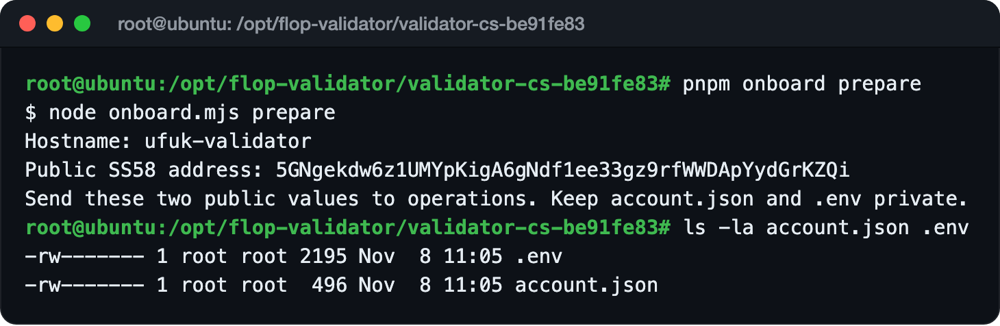

> [!CAUTION]
> `account.json` and `.env` hold your validator account's secret key. Never send them to
> anyone, never take screenshots of them and never upload them to GitHub. FLOP never asks for
> these files.

---

## 12. Back Up the Account

Back up both files to your own computer. First leave the server:

```bash
exit
```

Run these commands **in your own computer's terminal**:

```bash
mkdir -p ~/flop-validator-backup && chmod 700 ~/flop-validator-backup
scp root@SERVER_IP:/opt/flop-validator/validator-cs-be91fe83/account.json ~/flop-validator-backup/
scp root@SERVER_IP:/opt/flop-validator/validator-cs-be91fe83/.env ~/flop-validator-backup/
```

- If your server uses a different SSH port, add `-P PORT` right after `scp`.
- You should see `100%` for both files.

Then connect to the server again:

```bash
ssh root@SERVER_IP
```

Example output:

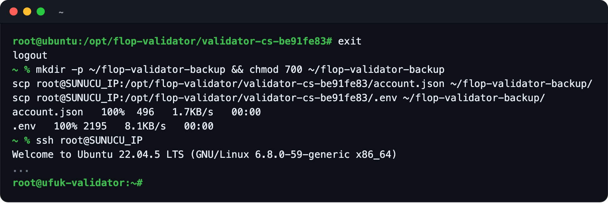

---

## 13. Collect the Details for FLOP

FLOP asks for three details. None of them is a secret:

```bash
hostname
jq -r .ss58Address /opt/flop-validator/validator-cs-be91fe83/account.json
cat /etc/ssh/ssh_host_ed25519_key.pub
ssh-keygen -lf /etc/ssh/ssh_host_ed25519_key.pub
```

1. **Hostname:** your server's name.
2. **SS58 address:** your validator account's address.
3. **SSH host public key:** the single line that starts with `ssh-ed25519`. FLOP encrypts the
   enrollment key it sends after admission to this key. It does not let FLOP log in to your
   server.

The value starting with `SHA256:` from the last command is the key's fingerprint. When FLOP
contacts you, it will ask you to confirm it on a second channel, such as email or a call.

Example output:

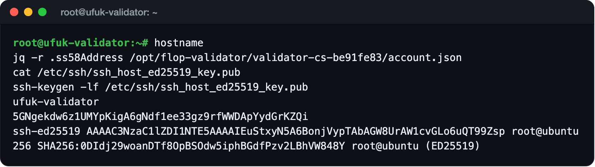

> [!CAUTION]
> The file ending in `.pub` is the public key and is safe to share. The file
> `/etc/ssh/ssh_host_ed25519_key`, without `.pub`, is your server's private key. Never share it.

---

## 14. Apply

### Interest form

This step needs no server.

1. Open https://flop.finance/apply/validator. It takes you to FLOP's Google form called "FLOP
   Validator Interest Form".
2. Fill in your email, name, region, Telegram and the other details.
3. Choose **Self-hosted** as the setup type and **Testnet** as the timing, and enter how many
   validators you plan to run.
4. Submit the form.

The form puts you on FLOP's interest list. It does not grant admission.

### The application thread on GitHub

FLOP's docs say:

- **If you are already talking to someone on the FLOP team,** send them the three details from
  step 13.
- **If you have no contact,** ask for an introduction with a comment in
  [#10](https://github.com/flop-labs/network/issues/10) on GitHub. The "Availability and access
  updates" link on FLOP's validator page also points there.

Your comment is public, so post only public details. You can fill in this text and post it:

```text
Devnet validator onboarding request. I have no operations contact yet.

Hostname: <hostname>
Public SS58 address: <5...>
SSH host public key (encryption recipient only): <ssh-ed25519 AAAA...>

Prepared with validator-cs-be91fe83 0.3.0-devnet.1: the archive SHA-256 matches the docs,
SHA256SUMS and node preflight.mjs pass, both Cosign signatures verify and pnpm onboard prepare
is done. Tailscale is installed and logged out (Tailscale SSH will stay off) and age is
installed. Nothing is started or registered.

Host: <cores> cores, <RAM> GB RAM, <disk> NVMe, <location>.
I can confirm the host key fingerprint on a second channel.
This comment contains only public values.
```

> [!NOTE]
> FLOP's docs say plainly that posting there does not grant admission and that no response time
> is promised. As of 8 November 2026 the thread has more than 40 comments and FLOP has not
> answered any of them. FLOP usually posts updates from [@flop_labs](https://x.com/flop_labs)
> on X. Watch there for the cap to open.

A "validator access" option is also expected in the GitHub Access request form
([#144](https://github.com/flop-labs/network/pull/144)). If it is added, you can apply there
too.

---

## After Admission (Not Tested Yet)

> [!IMPORTANT]
> This part is summarized from the `README.md` in FLOP's package. It has not been tested because
> FLOP has not admitted us yet. If FLOP gives you different instructions, follow theirs.

### 15. Set Up What FLOP Sends

After admission, FLOP sends you:

- **A single-use Tailscale key:** encrypted to your server's SSH key and valid for 24 hours. It
  comes with the `tailscale up` command that adds the server to FLOP's private network.
- **Stake:** FLOP funds your account with the FLOP needed to register, plus extra for fees.
- **`da-peers.json`:** a file with the private network addresses of the other validators.

Then:

1. Save the key block in the package folder as `tailnet-key.age` and run the command FLOP gives
   you.
2. Keep Tailscale SSH off:

   ```bash
   tailscale set --ssh=false
   ```

3. Save `da-peers.json` in the package folder, next to `README.md`.
4. Wait for FLOP to tell you its access checks are done.

### 16. Join the Network

```bash
cd /opt/flop-validator/validator-cs-be91fe83
pnpm onboard join
```

This starts the node and the DA program, waits up to an hour for the node to catch up with the
network and registers your account as a validator. Registration locks 1,200,000 FLOP of stake.
When it succeeds, you see this line:

```text
Ready: <your SS58 address>. Tell operations “ready”; activation is still pending their review.
```

Then tell FLOP "ready".

> [!WARNING]
> If `join` stops halfway, do not run it again and again. Do not delete the files in the folder
> or the `.join-attempt` file, and contact FLOP.

### 17. Activation and Check

FLOP reviews your registration and activates your validator. This can take two session
changes. After FLOP tells you that you are active, check it:

```bash
pnpm onboard verify
```

"Ready" does not mean active. This command and FLOP's confirmation show that you are active.

> [!CAUTION]
> Once active, do not shut the validator down without talking to FLOP first. Never run
> `docker compose down -v`: it deletes the node's data and keys.

---

## ! Common Errors

### `tailscale failed; no signing material was printed`

You ran `pnpm onboard join` before FLOP added your server to its private network. This is
normal before admission. Nothing starts and nothing is signed. It happened in our test too.

### `Receive da-peers.json from operations before joining`

The `da-peers.json` file from FLOP is not in the package folder. Follow step 15.

### `Existing .env has signing material; preserve it and reconcile the account locally`

The folder has `.env` but no `account.json`. Do not delete `.env`. Put `account.json` back from
your backup.

### `Local account and .env disagree`

`account.json` and `.env` belong to different accounts. Put both back from the same backup.

### `docker: command not found`

Docker is not installed. Follow step 4.

### The package link on the explorer returns `404`

You are using the old `0.2.0-devnet.1` link. Use the `0.3.0-devnet.1` link from step 8.

---

## FAQ

### Wasn't the devnet open to everyone?

For miners, yes: no application is needed and the network covers the stake. Not for
validators. FLOP's validator docs say devnet admission is controlled by FLOP's administrators.

### Can't I register with my own FLOP?

The chain can register an account that holds its own 1,200,000 FLOP as a validator. But on
devnet only FLOP can hand out that much FLOP. Also, the devnet's nodes only talk inside FLOP's
private network, so your server cannot connect to the devnet until FLOP adds it.

### When will I get an answer?

Nobody knows. FLOP does not promise a response time.

### Can I prepare on a cheap server and move later?

Your validator account lives in `account.json`. The package uses an `account.json` it finds in
the folder, so you can move the account to another server with your backup. But the enrollment
key FLOP sends is encrypted to the SSH key of the server whose details you sent. If you change
servers, you have to send the new server's SSH key to FLOP again. We have not tested a move.

### Does being a devnet validator help on testnet?

FLOP does not say so. According to FLOP's FAQ, testnet entry will be open to everyone, and the
first 1,000 mainnet validators will be chosen from the testnet participants.

---

## What Changes on Testnet?

According to the `PUBLIC-TESTNET.md` file in FLOP's package, the testnet page and the FAQ:

- A signed sponsorship request may be admitted automatically, within the network's caps.
- You will not need to join FLOP's private network (Tailscale). Nodes will connect over public
  ports 30333 (P2P) and 7001 (DA).
- The testnet is planned to open in the last quarter of 2026 and run for about 90 days. The
  dates are not final.
- According to FLOP, the testnet is the only route to the genesis airdrop.
- The first mainnet validator set will be 1,000 validators, chosen from the testnet
  participants. Each one gets the 1,200,000 FLOP stake for free, locked for 24 months.
- Recommended testnet hardware: 8+ cores, 64 GB RAM, 4 TB NVMe (2 TB at least) and a redundant
  1 Gbps connection.

FLOP writes that a few more pieces of work have to be finished before outside validators can
join the testnet.

---

## Security

- `prepare` creates a separate account for the validator. Never put your main wallet on any
  server.
- Only the hostname, the SS58 address and the SSH host public key (`.pub`) go to FLOP.
- `account.json`, `.env`, the node keys and the SSH private key stay on the server. FLOP never
  asks for them.
- The package keeps RPC (9944) and metrics (9615) reachable only from inside the server. Do not
  change that.
- On a rented server, the provider owns the machine. On mainnet, use a provider you trust or
  your own hardware.
- Before trusting any link, compare it with https://flop.finance/official/.

---

## Test Notes

Steps 1-13 of this guide were tested end to end on 8 November 2026 on a rented, freshly installed
server. The outputs in the pictures come from that run:

| Test | Result |
| --- | --- |
| Server | Ubuntu 22.04 (amd64), 11 cores, 12 GB RAM, 126 GB disk |
| System update | 315 packages upgraded |
| Docker | Installed with the official script: Docker 29.9.3, Compose v5.7.0 |
| Node.js | 24.22.2, checked against the checksum list |
| Tailscale | 1.104.5, logged out |
| cosign | v3.1.4, checksum verified |
| Package checksum | Matched the docs |
| Package files | 26 of 26 correct |
| Preflight | `verified`, 10 peers |
| Image signatures | `node-devnet` and `da-validator`: both `OK` |
| pnpm | 12.14.0, `pnpm install` in 1.3 seconds |
| `pnpm onboard prepare` | Account created, both files `-rw-------` |
| Backup | `account.json` and `.env` copied to our own computer |
| `pnpm onboard join` | In the first test on 7 November it stopped with `tailscale failed; no signing material was printed`. Nothing started and nothing was registered. This is the expected result without FLOP's approval |
| Admission, joining and activation | Not tested, because FLOP has not admitted us |

The preparation steps were also tested on 7 November 2026 on another Ubuntu 22.04 server, with the
same result. FLOP's side was checked again on 8 November 2026: the package, FLOP's docs (last
updated 6 November) and the admission process are unchanged. FLOP's 10 validators are active and
1 validator is waiting in the queue.

---

## Official Links

- FLOP Validator Docs: https://docs.flop.network/docs/run-validator
- Explorer Validator Page: https://explorer.devnet.flop.network/validator
- Validator Interest Form: https://flop.finance/apply/validator
- Applications and Access Updates (#10): https://github.com/flop-labs/network/issues/10
- FLOP Testnet Page: https://flop.finance/testnet/
- Official Links: https://flop.finance/official/

---

## Disclaimer

This guide is not investment advice and is not an official FLOP Labs guide. The devnet gives no
rewards and can be reset. There is no guarantee that FLOP will accept your application. Server,
disk and internet costs are yours. Before running the commands, check the current versions in
FLOP's official docs.

---

Prepared by [@UfukDegen](https://x.com/UfukDegen). Feel free to reach out with questions.
