# FLOP Validatör Hazırlık ve Başvuru Rehberi (Devnet)

**Türkçe** | [English](README.md)

> [!WARNING]
> **Önce bunu okuyun (8 Kasım 2026):** Bu rehber sizi validatör yapmaz, başvuruya hazırlar.
> Devnet'te validatörleri FLOP ekibi tek tek onaylıyor ve başvuruları hemen almıyor. FLOP
> 7 Kasım'da validatör sınırını
> [yavaş yavaş artıracağını yazdı](https://x.com/flop_labs/status/2119121264388526205). Bugün
> ağda sadece FLOP'un kendi 10 validatörü çalışıyor. Sponsorla kaydedilen tek yeni validatör de
> 6 Kasım'dan beri sırada bekliyor. GitHub'daki başvuru sayfasına 30'dan fazla kişi bilgilerini
> yazdı ve FLOP henüz hiçbirine cevap vermedi. Onay gelmeden büyük bir sunucu kiralamayın.

Bu rehber, FLOP Devnet'te validatör olmak için sunucusunu sıfırdan hazırlayıp başvurmak
isteyenler için hazırlandı.

Validatör, FLOP ağında blok üreten, blokların kesinleşmesi için oy veren ve ağın verilerini
saklayan bilgisayardır. Miner'ın aksine GPU gerekmez.

Rehber üç bölümden oluşur:

- **Hazırlık (1-13. adımlar):** Sunucuya bağlanma, gerekli programlar, paketin kontrolü,
  validatör hesabının oluşturulması ve FLOP'a gönderilecek bilgiler. Bu adımların hepsini
  sıfırdan kurulmuş bir sunucuda kendimiz denedik. Her adımın altında gerçek çıktısı var.
- **Başvuru (14. adım):** İlgi formu ve GitHub'daki başvuru sayfası.
- **Onaydan sonra (15-17. adımlar):** FLOP'un özel ağına katılma, ağa kayıt ve aktif olma. Bu
  adımlar FLOP'un onayını gerektirdiği için henüz denenemedi ve FLOP'un kendi belgesinden
  özetlendi.

GPU'nuz varsa miner da kurabilirsiniz. Miner için onay gerekmez:
[FLOP Miner Kurulum Rehberi](https://github.com/UfukNode/flop-miner-setup/blob/main/Turkce-Kurulum.md)

> [!IMPORTANT]
> Devnet bir test ağıdır. Ödül vermez, airdrop puanı vermez ve sıfırlanabilir. FLOP token henüz
> yoktur: "satın al", "claim et" veya "mint et" diyen her şey dolandırıcılıktır. FLOP'un resmi
> Discord veya Telegram kanalı yoktur. Size "onay" veya "whitelist" satmaya çalışan biri
> dolandırıcıdır. Resmi linklerin tamamı https://flop.finance/official/ sayfasındadır.

---

## Genel Bilgiler

| Bilgi | Değer |
| --- | --- |
| Ağ | FLOP Devnet |
| Rol | Validatör |
| GPU | Gerekmez |
| Paket | `validator-cs-be91fe83`, sürüm `0.3.0-devnet.1` |
| Kabul | FLOP ekibi elle onaylıyor |
| Stake | Kayıtta 1.200.000 devnet FLOP kilitlenir. Bu FLOP'u devnet'te FLOP ekibi yatırır |
| Ödül | Yok (devnet) |
| Resmi validatör dokümanı | https://docs.flop.network/docs/run-validator |
| Explorer | https://explorer.devnet.flop.network/validator |

---

## Sistem Gereksinimleri

| Parça | FLOP'un önerisi |
| --- | --- |
| İşlemci | 8 ayrılmış (dedicated) çekirdek |
| RAM | 32 GB. Testnet sayfası 64 GB öneriyor |
| Disk | 4 TB NVMe. Testnet sayfasına göre en az 2 TB |
| İnternet | 1 Gbps, kesintisiz |
| İşletim sistemi | Linux amd64 (Ubuntu 22.04 veya 24.04) |

FLOP bu değerlerin ölçülmüş devnet alt sınırları olmadığını, planlama tahminleri olduğunu
söylüyor.

Hazırlık adımları çok daha küçük bir makinede de çalışır. Biz 11 çekirdek, 12 GB RAM ve 126 GB
diskli bir sunucuda denedik. Ama FLOP'un onaydan sonra göndereceği giriş anahtarı, bilgilerini
gönderdiğiniz sunucunun SSH anahtarıyla şifrelenir ve sadece o sunucuda açılır. Bu yüzden
hazırlığı validatörü gerçekten çalıştıracağınız sunucuda yapın.

> [!TIP]
> Sunucunuz yoksa şimdilik sadece 14. adımdaki ilgi formunu doldurun. Sunucuyu FLOP'tan haber
> gelince kiralayın.

---

## 1. Sunucuya Bağlanma

Kendi bilgisayarınızın terminalinden sunucunuza bağlanın:

```bash
ssh root@SUNUCU_IP
```

- `SUNUCU_IP` yerine sunucunuzun IP adresini yazın. Sunucunuz farklı bir SSH portu kullanıyorsa
  komut `ssh -p PORT root@SUNUCU_IP` şeklinde olur.
- İlk bağlantıda `Are you sure you want to continue connecting (yes/no/[fingerprint])?` sorusu
  çıkar. `yes` yazıp Enter'a basın.
- Windows kullanıyorsanız önce WSL kurulum rehberimi takip edin:
  https://x.com/UfukDegen/status/1944066889346429338
- Bundan sonraki bütün komutlar sunucuda, `root` kullanıcısıyla çalıştırılır. Sunucuya normal
  bir kullanıcıyla bağlandıysanız önce `sudo -i` yazın.

Örnek çıktı:

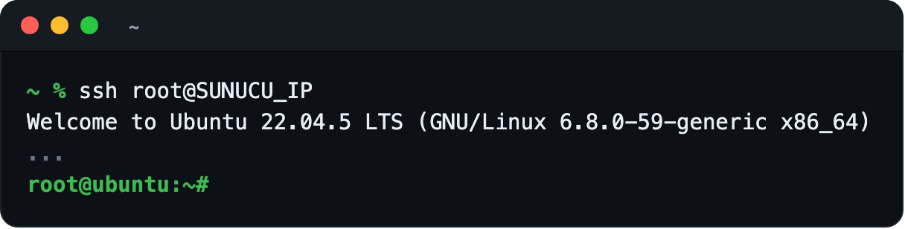

---

## 2. Sistemi Güncelleme ve Gerekli Paketler

```bash
apt update && apt upgrade -y
```

```bash
apt install -y curl jq age xz-utils
```

- Güncelleme birkaç dakika sürebilir.
- Ekranda hangi servislerin yeniden başlatılacağını soran mor bir pencere çıkarsa Enter'a basın.
- Güncelleme çekirdeği (kernel) de yenilerse, sonraki girişte `*** System restart required ***`
  yazısını görürsünüz. Hazırlık adımları için yeniden başlatmak gerekmez. İsterseniz `reboot`
  yazıp birkaç dakika sonra tekrar bağlanabilirsiniz.

Örnek çıktı:

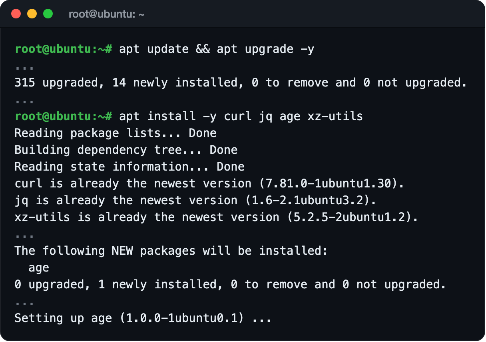

---

## 3. Sunucuya İsim Verme

FLOP sunucunuzu kendi özel ağına bu isimle ekler. İsmi FLOP'a gönderdikten sonra değiştirmeyin.

```bash
hostnamectl set-hostname validator-ismi-girin
hostname
```

- `validator-ismi-girin` yerine küçük harf, rakam ve tireden oluşan, size özel bir isim yazın.
- Son komut yeni ismi yazmalıdır.

Örnek çıktı:

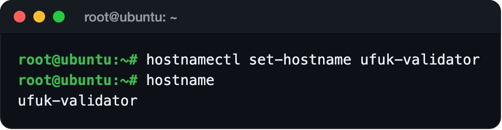

---

## 4. Docker Kurulumu

Yeni sunucuların çoğunda Docker kurulu gelmez. Docker'ın resmi kurulum betiğiyle kurun:

```bash
curl -fsSL https://get.docker.com | sh
```

Kurulumu kontrol edin:

```bash
docker --version && docker compose version
```

İki sürüm numarası görmelisiniz. Docker sunucunuzda zaten kuruluysa kurulum komutunu atlayıp
sadece kontrol komutunu çalıştırın.

Örnek çıktı:

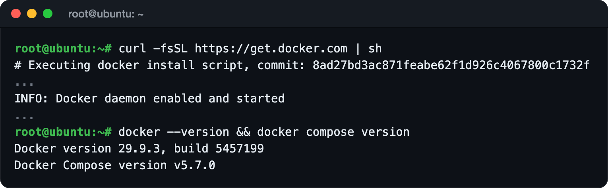

---

## 5. Node.js 24 ve pnpm Kurulumu

İndirilen dosya, Node.js'in kendi özet listesiyle doğrulanır:

```bash
cd /tmp
SUMS=$(curl -fsSL https://nodejs.org/dist/latest-v24.x/SHASUMS256.txt)
NODE_TGZ=$(echo "$SUMS" | awk '/linux-x64\.tar\.xz$/{print $2}')
curl -fsSLO "https://nodejs.org/dist/latest-v24.x/$NODE_TGZ"
echo "$SUMS" | grep " $NODE_TGZ\$" | sha256sum -c -
tar -xJf "$NODE_TGZ" -C /usr/local --strip-components=1
node -v
corepack enable
```

`...linux-x64.tar.xz: OK` satırını ve `v24` ile başlayan bir sürüm görmelisiniz. `corepack`,
paketin istediği pnpm sürümünü (12.14.0) ilk kullanımda kendisi indirir.

Örnek çıktı:

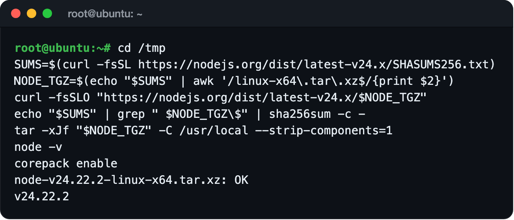

---

## 6. Tailscale Kurulumu

Tailscale kurulur ama giriş yapılmaz:

```bash
. /etc/os-release
curl -fsSL "https://pkgs.tailscale.com/stable/ubuntu/$VERSION_CODENAME.noarmor.gpg" -o /usr/share/keyrings/tailscale-archive-keyring.gpg
curl -fsSL "https://pkgs.tailscale.com/stable/ubuntu/$VERSION_CODENAME.tailscale-keyring.list" -o /etc/apt/sources.list.d/tailscale.list
apt update && apt install -y tailscale
tailscale status
```

Son komut `Logged out.` yazmalıdır.

Örnek çıktı:

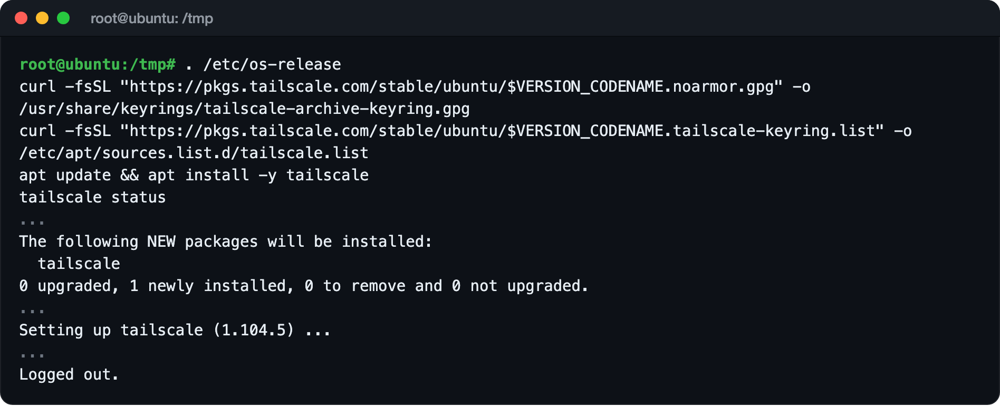

> [!CAUTION]
> `tailscale up` veya `tailscale login` komutlarını çalıştırmayın. Sunucunuzu FLOP'un özel
> ağına, onaydan sonra FLOP'un göndereceği tek kullanımlık anahtar ekler.

---

## 7. cosign Kurulumu

FLOP'un Docker imajlarının imzasını 9. adımda bu araçla doğrulayacağız:

```bash
cd /tmp
curl -fsSLO https://github.com/sigstore/cosign/releases/download/v3.1.4/cosign-linux-amd64
curl -fsSL https://github.com/sigstore/cosign/releases/download/v3.1.4/cosign_checksums.txt | grep ' cosign-linux-amd64$' | sha256sum -c -
install -m 755 cosign-linux-amd64 /usr/local/bin/cosign
```

`cosign-linux-amd64: OK` görmelisiniz.

Örnek çıktı:

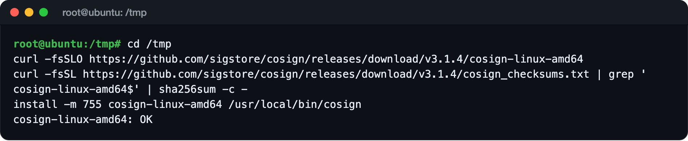

---

## 8. Paketi İndirme ve Doğrulama

```bash
mkdir -p /opt/flop-validator && cd /opt/flop-validator
curl -fsSLO https://explorer.devnet.flop.network/validator-downloads/validator-cs-be91fe83-0.3.0-devnet.1.tar.gz
echo "bf98e281b7d3217fb52e9aeba75886d2165e66d32f0159dbc3f1f2e998e30ba7  validator-cs-be91fe83-0.3.0-devnet.1.tar.gz" | sha256sum -c -
tar -xzf validator-cs-be91fe83-0.3.0-devnet.1.tar.gz
cd validator-cs-be91fe83
sha256sum -c SHA256SUMS | grep -c ': OK$'
node preflight.mjs
```

- Uzun değer, FLOP'un validatör belgesinde yayınlanan paket özetidir.
- Sırasıyla `OK`, `26` (26 dosyanın hepsi doğru) ve son satırda `verified` görmelisiniz.
- `finalized` ve `peers` sayıları sizde farklı olur.

Örnek çıktı:

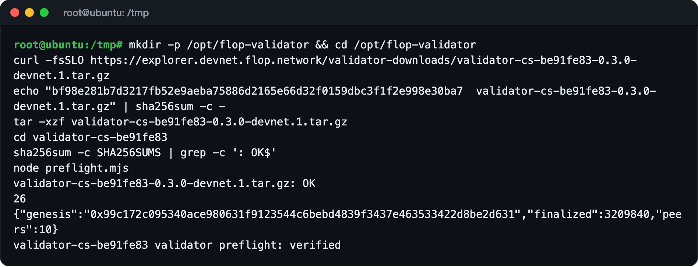

> [!NOTE]
> Explorer'daki eski `0.2.0-devnet.1` linki çalışmıyor (404). Güncel paket `0.3.0-devnet.1`.

---

## 9. İmzaları Doğrulama

Bu komut, paketin kullanacağı iki Docker imajının gerçekten FLOP'un GitHub'ında üretildiğini
doğrular:

```bash
WF=https://github.com/flop-labs/flop-core/.github/workflows/build-services.yml@refs/heads/main
for IMG in \
  ghcr.io/flop-labs/flop-core/node-devnet@sha256:84498fd73db2464eb13088ab34d369ddf7cddd22a45c810d140c9ff8ec16c91d \
  ghcr.io/flop-labs/flop-core/da-validator@sha256:c6709bb5bba04978a7800daccd87bb2bf916edd34d7dbf09f84aba5be9aca949; do
  if cosign verify "$IMG" --certificate-oidc-issuer https://token.actions.githubusercontent.com --certificate-identity "$WF" >/dev/null 2>&1; then echo "OK: ${IMG%%@*}"; else echo "FAILED: ${IMG%%@*}"; fi
done
```

İki satırda da `OK` görmelisiniz. `FAILED` görürseniz devam etmeyin.

Örnek çıktı:

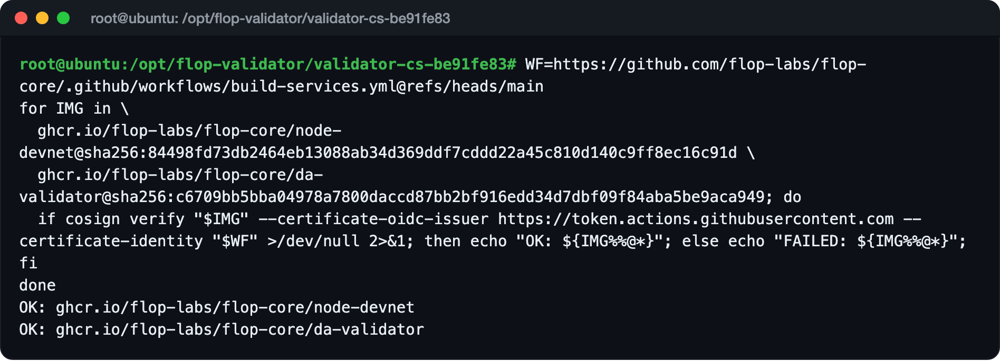

---

## 10. Bağımlılıkları Kurma

```bash
cd /opt/flop-validator/validator-cs-be91fe83
export COREPACK_ENABLE_DOWNLOAD_PROMPT=0
pnpm --version
pnpm install --frozen-lockfile --ignore-scripts
```

`12.14.0` sürümünü ve sonunda `Done in ...` satırını görmelisiniz. Ekranda `Update available!`
yazısı çıkarsa pnpm'i güncellemeyin. Paket 12.14.0 sürümüyle çalışacak şekilde hazırlanmış.

Örnek çıktı:

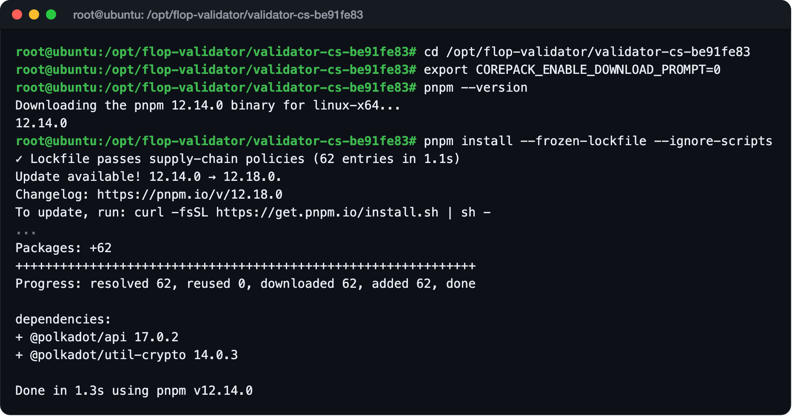

---

## 11. Validatör Hesabını Oluşturma

```bash
pnpm onboard prepare
```

Bu komut FLOP'un node imajını (233 MB) indirir ve validatör hesabınızı oluşturur.

- `Hostname`, 3. adımda verdiğiniz isimdir.
- `Public SS58 address`, validatör hesabınızın adresidir ve `5` ile başlar. Bu adres gizli
  değildir.
- Komut "iki bilgi" dese de FLOP'un güncel belgesi, 13. adımdaki SSH anahtarıyla birlikte üç
  bilgi istiyor.

Komutun oluşturduğu iki dosyayı kontrol edin:

```bash
ls -la account.json .env
```

İkisi de `-rw-------` izniyle görünmelidir.

Örnek çıktı:

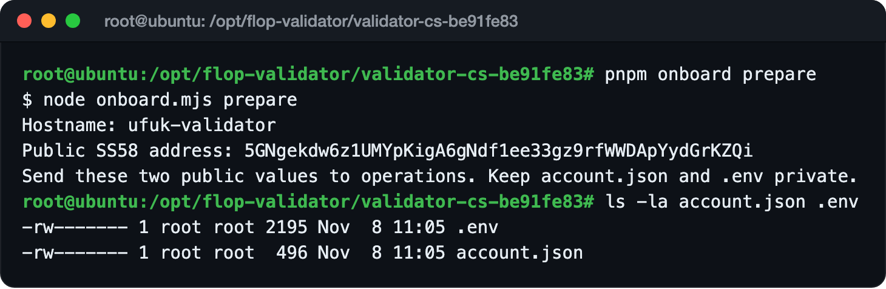

> [!CAUTION]
> `account.json` ve `.env` validatör hesabınızın gizli anahtarını içerir. Kimseye göndermeyin,
> ekran görüntüsünü almayın ve GitHub'a yüklemeyin. FLOP da bu dosyaları istemez.

---

## 12. Yedek Alma

Bu iki dosyanın yedeğini kendi bilgisayarınıza alın. Önce sunucudan çıkın:

```bash
exit
```

Aşağıdaki komutları **kendi bilgisayarınızın terminalinde** çalıştırın:

```bash
mkdir -p ~/flop-validator-backup && chmod 700 ~/flop-validator-backup
scp root@SUNUCU_IP:/opt/flop-validator/validator-cs-be91fe83/account.json ~/flop-validator-backup/
scp root@SUNUCU_IP:/opt/flop-validator/validator-cs-be91fe83/.env ~/flop-validator-backup/
```

- Sunucunuz farklı bir SSH portu kullanıyorsa `scp` kelimesinden sonra `-P PORT` ekleyin.
- İki dosya için de `100%` görmelisiniz.

Ardından sunucuya tekrar bağlanın:

```bash
ssh root@SUNUCU_IP
```

Örnek çıktı:

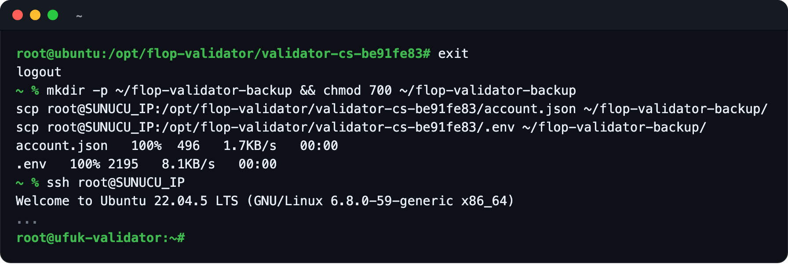

---

## 13. FLOP'a Gönderilecek Bilgileri Alma

FLOP üç bilgi istiyor. Üçü de gizli değildir:

```bash
hostname
jq -r .ss58Address /opt/flop-validator/validator-cs-be91fe83/account.json
cat /etc/ssh/ssh_host_ed25519_key.pub
ssh-keygen -lf /etc/ssh/ssh_host_ed25519_key.pub
```

1. **Hostname:** Sunucunuzun ismi.
2. **SS58 adresi:** Validatör hesabınızın adresi.
3. **SSH host açık anahtarı:** `ssh-ed25519` ile başlayan tek satır. FLOP, onaydan sonra
   göndereceği giriş anahtarını bununla şifreler. Bu anahtar FLOP'a sunucunuza giriş izni
   vermez.

Son komutun yazdığı `SHA256:` ile başlayan değer, anahtarın parmak izidir. FLOP sizinle
iletişime geçtiğinde bu değeri ikinci bir kanaldan, örneğin e-posta veya görüşmeyle teyit
etmenizi ister.

Örnek çıktı:

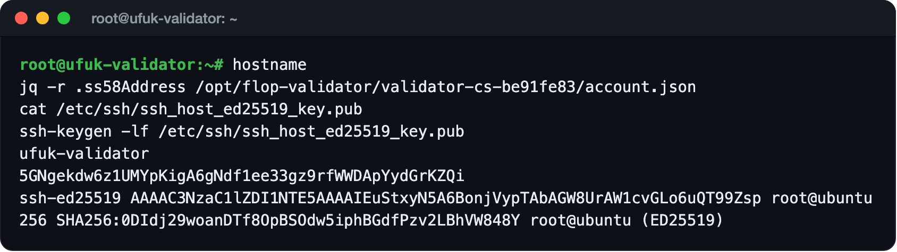

> [!CAUTION]
> Sonu `.pub` olan dosya açık anahtardır ve paylaşılabilir. Sonunda `.pub` olmayan
> `/etc/ssh/ssh_host_ed25519_key` dosyası ise sunucunuzun gizli anahtarıdır. Onu asla
> paylaşmayın.

---

## 14. Başvuru

### İlgi formu

Bu adım için sunucu gerekmez.

1. https://flop.finance/apply/validator adresini açın. Adres sizi FLOP'un "FLOP Validator
   Interest Form" adlı Google formuna götürür.
2. E-posta, isim, bölge ve Telegram gibi bilgileri doldurun.
3. Kurulum türü olarak **Self-hosted** (kendi sunucunuz), zaman olarak **Testnet** seçin ve kaç
   validatör çalıştıracağınızı yazın.
4. Formu gönderin.

Form sizi FLOP'un ilgi listesine ekler, onay vermez.

### GitHub'daki başvuru sayfası

FLOP'un belgesine göre:

- **FLOP ekibinden biriyle zaten konuşuyorsanız** 13. adımdaki üç bilgiyi ona gönderin.
- **Kimseyle iletişiminiz yoksa** GitHub'daki [#10](https://github.com/flop-labs/network/issues/10)
  sayfasına yorum yazarak tanıştırılma isteyin. FLOP'un validatör sayfasındaki "Availability and
  access updates" bağlantısı da bu sayfaya gider.

Yorumunuz herkese açıktır, bu yüzden sadece açık bilgileri yazın. Aşağıdaki İngilizce metni
kendi bilgilerinizle doldurup gönderebilirsiniz:

```text
Devnet validator onboarding request. I have no operations contact yet.

Hostname: <hostname>
Public SS58 address: <5...>
SSH host public key (encryption recipient only): <ssh-ed25519 AAAA...>

Prepared with validator-cs-be91fe83 0.3.0-devnet.1: the archive SHA-256 matches the docs,
SHA256SUMS and node preflight.mjs pass, both Cosign signatures verify and pnpm onboard prepare
is done. Tailscale is installed and logged out (Tailscale SSH will stay off) and age is
installed. Nothing is started or registered.

Host: <cores> cores, <RAM> GB RAM, <disk> NVMe, <location>.
I can confirm the host key fingerprint on a second channel.
This comment contains only public values.
```

> [!NOTE]
> FLOP'un belgesi, bu sayfaya yazmanın onay anlamına gelmediğini ve cevap süresi sözü
> verilmediğini açıkça yazıyor. 8 Kasım 2026 itibarıyla sayfada 40'tan fazla yorum var ve FLOP
> hiçbirine cevap vermedi. FLOP güncellemeleri genellikle X'teki
> [@flop_labs](https://x.com/flop_labs) hesabından paylaşıyor. Sınırın açıldığını oradan takip
> edin.

GitHub'daki erişim isteği formuna (Access request) "validator access" seçeneği eklenmesi de
bekleniyor ([#144](https://github.com/flop-labs/network/pull/144)). Eklenirse başvuruyu oradan da
yapabilirsiniz.

---

## Onaydan Sonra (Henüz Denenmedi)

> [!IMPORTANT]
> Bu bölüm FLOP'un paketindeki `README.md` dosyasından özetlendi. FLOP onay vermediği için
> henüz denenemedi. FLOP size farklı bir talimat verirse onun talimatına uyun.

### 15. FLOP'un Gönderdiklerini Kurma

Onaydan sonra FLOP size şunları gönderir:

- **Tek kullanımlık Tailscale anahtarı:** Sunucunuzun SSH anahtarıyla şifrelenmiştir ve 24 saat
  geçerlidir. Yanında, sunucuyu FLOP'un özel ağına ekleyen `tailscale up` komutu gelir.
- **Stake:** Hesabınıza kayıt için gereken FLOP'u ve ücretler için fazlasını yatırır.
- **`da-peers.json`:** Diğer validatörlerin özel ağdaki adreslerini içeren dosya.

Yapılacaklar:

1. Anahtar bloğunu paket klasörüne `tailnet-key.age` adıyla kaydedin ve FLOP'un verdiği komutu
   çalıştırın.
2. Tailscale SSH'ı kapalı tutun:

   ```bash
   tailscale set --ssh=false
   ```

3. `da-peers.json` dosyasını paket klasörüne, `README.md` dosyasının yanına kaydedin.
4. FLOP'un erişim kontrollerini yaptığını size bildirmesini bekleyin.

### 16. Ağa Katılma

```bash
cd /opt/flop-validator/validator-cs-be91fe83
pnpm onboard join
```

Bu komut node'u ve DA programını başlatır, node'un ağa yetişmesini en fazla bir saat bekler ve
hesabınızı validatör olarak kaydeder. Kayıt 1.200.000 FLOP stake'i kilitler. Başarılı olursa
şu satır görünür:

```text
Ready: <SS58 adresiniz>. Tell operations “ready”; activation is still pending their review.
```

Ardından FLOP'a "ready" yazın.

> [!WARNING]
> `join` yarıda kalırsa komutu tekrar tekrar çalıştırmayın. Klasördeki dosyaları ve
> `.join-attempt` dosyasını silmeyin, FLOP ile iletişime geçin.

### 17. Aktif Olma ve Kontrol

FLOP kaydınızı kontrol edip validatörünüzü aktif eder. Bu, iki oturum (session) değişimi
kadar sürebilir. FLOP aktif olduğunuzu bildirdikten sonra kontrol edin:

```bash
pnpm onboard verify
```

"Ready" demek aktif olmak demek değildir. Aktif olduğunuzu bu komut ve FLOP'un onayı gösterir.

> [!CAUTION]
> Aktif olduktan sonra validatörü FLOP'la konuşmadan kapatmayın. `docker compose down -v`
> komutunu asla çalıştırmayın. Bu komut node'un verilerini ve anahtarlarını siler.

---

## ! Sık Karşılaşılan Hatalar

### `tailscale failed; no signing material was printed`

`pnpm onboard join` komutunu, FLOP sunucunuzu özel ağına eklemeden çalıştırdınız. Onaydan önce
bu normaldir. Hiçbir program başlamaz ve hiçbir işlem imzalanmaz. Testte de böyle oldu.

### `Receive da-peers.json from operations before joining`

FLOP'un gönderdiği `da-peers.json` dosyası paket klasöründe değil. 15. adımı uygulayın.

### `Existing .env has signing material; preserve it and reconcile the account locally`

Klasörde `.env` var ama `account.json` yok. `.env` dosyasını silmeyin, `account.json`
dosyasını yedeğinizden geri koyun.

### `Local account and .env disagree`

`account.json` ve `.env` farklı hesaplara ait. İkisini de aynı yedekten geri koyun.

### `docker: command not found`

Docker kurulu değil. 4. adımı uygulayın.

### Explorer'daki paket linki `404` veriyor

Eski `0.2.0-devnet.1` linkini kullanıyorsunuz. 8. adımdaki `0.3.0-devnet.1` linkini kullanın.

---

## Sık Sorulan Sorular

### Devnet herkese açık değil miydi?

Miner'lar için açık: başvuru gerekmez ve stake'i ağ karşılar. Validatörler için değil. FLOP'un
validatör belgesi, devnet'te kabulün FLOP yöneticilerinin kontrolünde olduğunu yazıyor.

### Kendi FLOP'umla kayıt olamaz mıyım?

Zincir, kendi 1.200.000 FLOP'u olan bir hesabı validatör olarak kaydedebiliyor. Ama devnet'te bu
kadar FLOP'u sadece FLOP verebiliyor. Ayrıca devnet'in node'ları sadece FLOP'un özel ağı içinde
konuşuyor. FLOP sizi bu ağa eklemeden sunucunuz devnet'e bağlanamaz.

### Ne zaman cevap gelir?

Belli değil. FLOP cevap süresi sözü vermiyor.

### Hazırlığı ucuz bir sunucuda yapıp sonra taşıyabilir miyim?

Validatör hesabınız `account.json` dosyasındadır. Paket, klasörde bulduğu `account.json`
dosyasını kullanır, yani hesabı yedeğiyle başka bir sunucuya taşıyabilirsiniz. Ama FLOP'un
göndereceği giriş anahtarı, bilgilerini gönderdiğiniz sunucunun SSH anahtarıyla şifrelenir.
Sunucu değiştirirseniz yeni sunucunun SSH anahtarını FLOP'a tekrar göndermeniz gerekir. Taşımayı
biz denemedik.

### Devnet'te validatör olmak testnet'te avantaj sağlar mı?

FLOP böyle bir şey söylemiyor. FLOP'un SSS sayfasına göre testnet girişi herkese açık olacak ve
mainnet'in ilk 1.000 validatörü testnet katılımcıları arasından seçilecek.

---

## Testnet'te Ne Değişecek?

FLOP'un paketindeki `PUBLIC-TESTNET.md` dosyasına, testnet sayfasına ve SSS sayfasına göre:

- İmzalı bir sponsor isteği, ağın sınırları içinde otomatik olarak kabul edilebilecek.
- FLOP'un özel ağına (Tailscale) girmek gerekmeyecek. Node'lar herkese açık 30333 (P2P) ve 7001
  (DA) portlarıyla bağlanacak.
- Testnet'in 2026'nın son çeyreğinde açılması ve yaklaşık 90 gün sürmesi planlanıyor. Tarihler
  kesin değil.
- FLOP'a göre genesis airdrop'ına giden tek yol testnet.
- Mainnet'in ilk validatör seti 1.000 validatör olacak ve testnet katılımcıları arasından
  seçilecek. Seçilen her validatöre 1.200.000 FLOP'luk stake ücretsiz verilecek ve 24 ay kilitli
  kalacak.
- Testnet için önerilen donanım: 8+ çekirdek, 64 GB RAM, 4 TB NVMe (en az 2 TB) ve 1 Gbps
  yedekli bağlantı.

FLOP, testnet'te dışarıdan validatör alınabilmesi için birkaç işin daha bitmesi gerektiğini
yazıyor.

---

## Güvenlik

- `prepare` validatör için ayrı bir hesap oluşturur. Ana cüzdanınızı hiçbir sunucuya koymayın.
- FLOP'a sadece hostname, SS58 adresi ve SSH host açık anahtarı (`.pub`) gönderilir.
- `account.json`, `.env`, node anahtarları ve SSH gizli anahtarı sunucuda kalır. FLOP bunları
  hiçbir zaman istemez.
- Paket, RPC (9944) ve metrics (9615) portlarını sadece sunucunun içinden erişilebilir tutar. Bu
  ayarı değiştirmeyin.
- Kiralık sunucuda sağlayıcı makinenin sahibidir. Mainnet'te güvendiğiniz bir sağlayıcı veya
  kendi donanımınızı kullanın.
- Herhangi bir linke güvenmeden önce https://flop.finance/official/ sayfasıyla karşılaştırın.

---

## Test Notları

Bu rehberdeki 1-13. adımlar 8 Kasım 2026'da kiralık, sıfırdan kurulmuş bir sunucuda baştan sona
denendi. Görsellerdeki çıktılar bu denemeden alındı:

| Test | Sonuç |
| --- | --- |
| Sunucu | Ubuntu 22.04 (amd64), 11 çekirdek, 12 GB RAM, 126 GB disk |
| Sistem güncellemesi | 315 paket güncellendi |
| Docker | Resmi betikle kuruldu: Docker 29.9.3, Compose v5.7.0 |
| Node.js | 24.22.2, özet listesiyle doğrulandı |
| Tailscale | 1.104.5, oturum kapalı |
| cosign | v3.1.4, özeti doğrulandı |
| Paket özeti | Belgedeki değerle eşleşti |
| Paket dosyaları | 26 dosyanın 26'sı doğru |
| Preflight | `verified`, 10 bağlantı (peer) |
| İmajların imzası | `node-devnet` ve `da-validator`: ikisi de `OK` |
| pnpm | 12.14.0, `pnpm install` 1,3 saniye |
| `pnpm onboard prepare` | Hesap oluşturuldu, iki dosya da `-rw-------` |
| Yedek | `account.json` ve `.env` kendi bilgisayara kopyalandı |
| `pnpm onboard join` | 7 Kasım'daki ilk denemede `tailscale failed; no signing material was printed` ile durdu. Hiçbir program başlamadı, kayıt yapılmadı. FLOP'un onayı olmadan beklenen sonuç |
| Onay, katılma ve aktif olma | FLOP onay vermediği için denenemedi |

Hazırlık adımları 7 Kasım 2026'da başka bir Ubuntu 22.04 sunucuda da denenmişti, sonuç aynıydı.
8 Kasım 2026'da FLOP tarafı da tekrar kontrol edildi: paket, FLOP'un belgesi (son güncelleme
6 Kasım) ve kabul yöntemi aynı. Ağda FLOP'un 10 validatörü aktif, sırada 1 validatör bekliyor.

---

## Resmi Kaynaklar

- FLOP Validatör Dokümanı: https://docs.flop.network/docs/run-validator
- Explorer Validatör Sayfası: https://explorer.devnet.flop.network/validator
- Validatör İlgi Formu: https://flop.finance/apply/validator
- Başvuru ve Erişim Güncellemeleri (#10): https://github.com/flop-labs/network/issues/10
- FLOP Testnet Sayfası: https://flop.finance/testnet/
- Resmi Linkler: https://flop.finance/official/

---

## Disclaimer

Bu rehber yatırım tavsiyesi değildir ve FLOP Labs'in resmi rehberi değildir. Devnet ödül vermez
ve sıfırlanabilir. FLOP'un başvurunuzu kabul edeceğinin garantisi yoktur. Sunucu, disk ve
internet masrafları size aittir. Komutları çalıştırmadan önce FLOP'un resmi dokümanındaki güncel
sürümleri kontrol edin.

---

Hazırlayan: [@UfukDegen](https://x.com/UfukDegen)
Sorularınız için bana ulaşabilirsiniz.
