# FLOP Testnet Validatör Hazırlık Rehberi

**Türkçe** | [English](README.md)

FLOP testnette ilk 50 validatör koltuğu için kayıt açtı. FLOP adaylardan iki şey istiyor: ekibini
kaydetmek ve GPU'suz bir sunucuda anahtarsız bir devnet düğümüyle prova yapmak. Bu rehber ikisini de
adım adım yaptırır.

> [!WARNING]
> Kayıt koltuk garantisi değildir; koltuk, sponsorluk ve aktivasyon ayrı adımlardır. Validatör
> anahtarları ve tören paketi FLOP zincir yazılımını dondurduğunda yayınlanacak, bu rehber o zaman
> güncellenecek. Test FLOP'un parasal değeri yoktur.

Adımlar 24 Kasım 2026'da kiralık bir Ubuntu 22.04 sunucuda baştan sona denendi.

---

## Sistem Gereksinimleri

| Parça | Testnet validatörü (FLOP referansı) | Prova için yeterli |
| --- | --- | --- |
| İşlemci | 8 fiziksel çekirdek, 3,4 GHz veya üstü | 4 vCPU |
| RAM | 32 GB ECC (64 GB önerilen) | 16 GB |
| Disk | 4 TB kurumsal NVMe | 300 GB SSD |
| İnternet | 1 Gbps simetrik | Sabit IPv4, açık TCP 30333 |
| GPU | Gerekmez | Gerekmez |

- Provayı validatörü çalıştıracağınız sunucuda yapmanız en doğrusu.

---

## 1. Ekibinizi Kaydedin

Başvuru formu: https://github.com/flop-labs/network/issues/new?template=operator-application.yml

- **Network** alanında `testnet`, **Requested role** alanında `validator candidate` seçin.
- Ekip adınızı, kaç sunucu planladığınızı, sağlayıcı ve bölgeyi yazın. Sunucu hazır olmadan da
  kaydolabilirsiniz.
- Ekip başına tek başvuru açın ve GitHub'ın web sayfasından gönderin. Başvuru herkese açıktır:
  tohum kelimesi, anahtar veya şifre yazmayın.

Örnek başvuru:

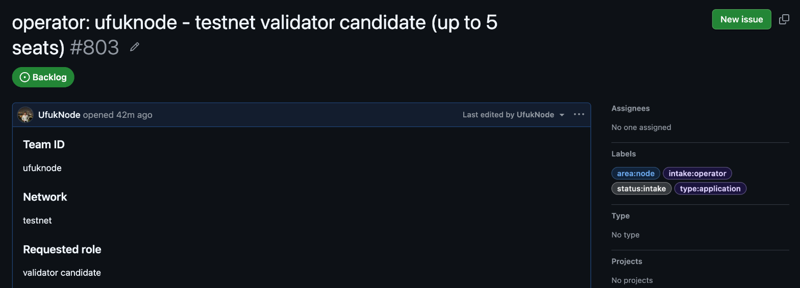

---

## 2. Sunucuya Bağlanma

```bash
ssh root@SUNUCU_IP
```

- `SUNUCU_IP` yerine sunucunuzun IP adresini yazın. Farklı bir SSH portu varsa:
  `ssh -p PORT root@SUNUCU_IP`
- Windows kullanıyorsanız önce WSL rehberimi takip edin:
  https://x.com/UfukDegen/status/1944066889346429338

Örnek çıktı:

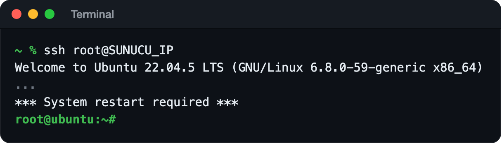

---

## 3. Gerekli Araçlar

```bash
apt-get update && apt-get install -y curl jq zstd
```

Örnek çıktı:

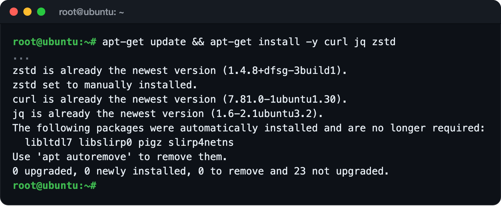

---

## 4. Docker Kurulumu

```bash
curl -fsSL https://get.docker.com | sh
```

```bash
docker --version && docker compose version
```

- Docker zaten kuruluysa ilk komutu atlayın.

Örnek çıktı:

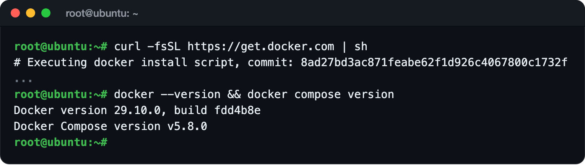

---

## 5. FLOP Dosyalarını İndirme

```bash
mkdir -p ~/flop-devnet-rpc && cd ~/flop-devnet-rpc
files=https://gist.githubusercontent.com/sv/7c8b93f3868bc15e3b6eabe0578057e3/raw/21adaa99c601003278d1682bf937696f21d31432
for file in docker-compose.rpc.yml node-entrypoint.sh rpc_ready.py rpc-pool.env.example rpc-origin.Caddyfile; do
  curl -fsSL -o "$file" "$files/$file"
done
sha256sum --check <<'SUMS'
6487cd84d5a257659297ad7b8fdd55978e6d8327bfe029d9460645da2591345d  docker-compose.rpc.yml
7279e81c0d6de4b6c59733b64132f929b8b7dd5825b8f37433d09940a93f983d  node-entrypoint.sh
6a066b7540628c7db4f455d7bfd2540db54355a4c0a2959d97032b76bcf641cd  rpc_ready.py
4f7295735f75b5a7b4c0babe3be4b0eef687decab99ba1612f91ee6f3b04d1bb  rpc-pool.env.example
e184d4f38f054dbe7947efde4d85e6a8964f02e594666ad42b9216dd98a4b2d5  rpc-origin.Caddyfile
SUMS
```

- Beş dosyada da `OK` görmelisiniz. Dosyalar FLOP'un
  [kendi rehberinden](https://gist.github.com/sv/7c8b93f3868bc15e3b6eabe0578057e3) gelir.

Örnek çıktı:

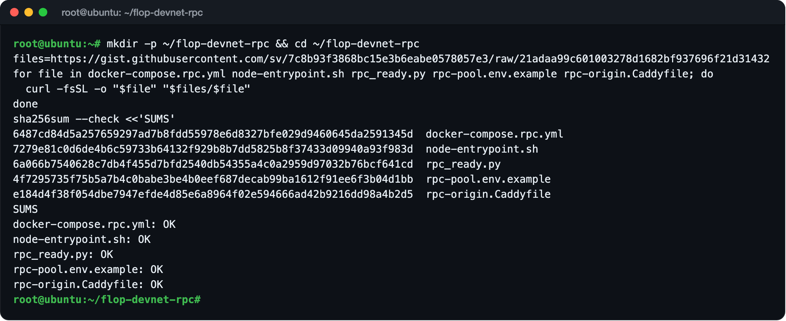

---

## 6. Zincir Tanımını İndirme

```bash
curl -fsSL -o chain.raw.json https://explorer.devnet.flop.network/validator-downloads/flop_devnet_ts-99c172c095340ace.raw.json
echo "3b213c38e7678285bc38fbdfded5dbe3d6acbd16e836b14aaaeef2f6ae1cd16e  chain.raw.json" | sha256sum --check
cp -n rpc-pool.env.example rpc-pool.env
```

Örnek çıktı:

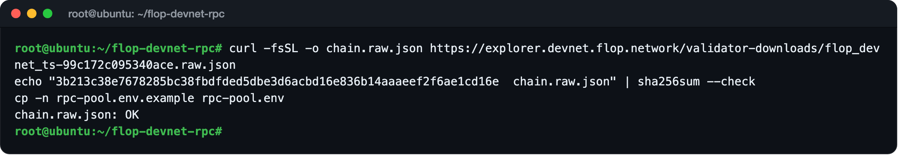

---

## 7. Ayarları Yazma

```bash
P2P_PORT_DIS=30333
sed -i "s#^HOST_IP=.*#HOST_IP=$(ip -4 route get 1.1.1.1 | awk '{print $7}')#" rpc-pool.env
sed -i "s#^PUBLIC_ADDR=.*#PUBLIC_ADDR=/ip4/$(curl -4fsS https://ifconfig.me)/tcp/$P2P_PORT_DIS#" rpc-pool.env
grep -E '^(HOST_IP|RPC_BIND_IP|PROMETHEUS_BIND_IP|STATE_PRUNING)=' rpc-pool.env
```

- Sağlayıcınızın panelinde TCP 30333'ü dışarıya açın. Sağlayıcı bu portu başka bir numarayla
  yönlendiriyorsa ilk satıra o numarayı yazın (görseldeki sunucuda 32014).
- `RPC_BIND_IP` ve `PROMETHEUS_BIND_IP` `127.0.0.1` kalmalı.

Örnek çıktı:

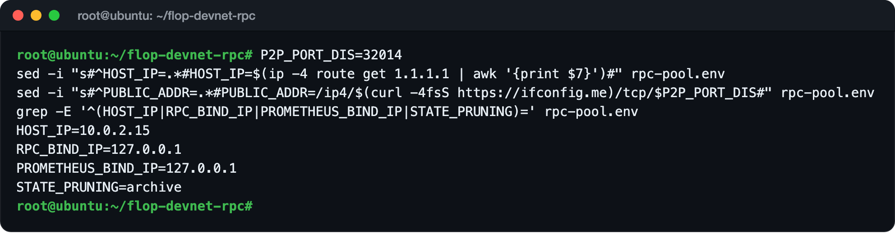

---

## 8. Düğümü Başlatma

```bash
dc() { docker compose --env-file ~/flop-devnet-rpc/rpc-pool.env -f ~/flop-devnet-rpc/docker-compose.rpc.yml "$@"; }
dc config --quiet && dc up -d
```

```bash
dc logs --tail=40 rpc | grep -E "Syncing|Imported|finalized" | tail -4
curl -s -o /dev/null -w '%{http_code}\n' http://127.0.0.1:9619/ready
```

- `503` normal: düğüm senkron oluyor. Sunucuya yeniden bağlandığınızda `dc` satırını tekrar
  yapıştırın.

Örnek çıktı:

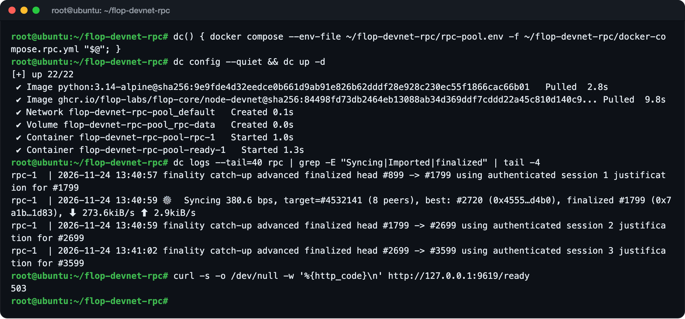

---

## 9. FLOP'un Günlük Yedeğini İndirme

Baştan senkron yaklaşık 3 saat sürer. FLOP'un günlük yedeğiyle birkaç dakikaya iner.

```bash
mkdir -p ~/flop-devnet-rpc/seed && cd ~/flop-devnet-rpc/seed
BASE=https://snapshots.flop.network/devnet-ts/archive
curl -fsS -o latest.json "$BASE/latest.json"
jq -r '.name, .genesis_hash' latest.json
jq -r '.parts[] | "\(.sha256)  \(.file)"' latest.json > SHA256SUMS
jq -r '.parts[] | .file' latest.json | while read -r f; do curl -fsS -C - -o "$f" "$BASE/$(jq -r .name latest.json)/$f"; done
sha256sum --check SHA256SUMS
mkdir -p unpack && jq -r '.parts[].file' latest.json | xargs cat | zstd -d | tar -x -C unpack && ls unpack
```

- Yedek yaklaşık 42 GB. Diskte en az 120 GB boş yer olsun.
- Yarıda kalırsa aynı bloğu tekrar yapıştırın, kaldığı yerden devam eder.

Örnek çıktı:

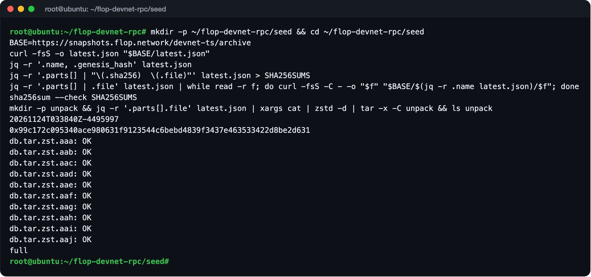

---

## 10. Yedeği Düğüme Yükleme

```bash
cd ~/flop-devnet-rpc && dc stop
db="$(docker volume inspect -f '{{.Mountpoint}}' flop-devnet-rpc-pool_rpc-data)/chains/flop_devnet_ts/db"
mv "$db/full" "$db/full.from-genesis" && mv seed/unpack/full "$db/full" && chown -R --reference="$db" "$db/full"
dc up -d
```

```bash
until curl -fs -o /dev/null http://127.0.0.1:9619/ready; do sleep 5; done; echo ready
```

- `ready` yazınca düğüm zincire yetişmiştir.
- Sonra yer açmak için: `rm -rf ~/flop-devnet-rpc/seed "$db/full.from-genesis"`

Örnek çıktı:

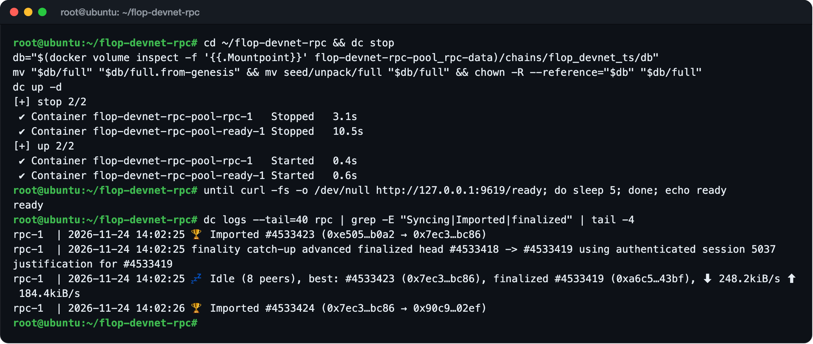

---

## 11. Kontrol

```bash
rpc() { curl -fsS --max-time 15 "$1" -H 'Content-Type: application/json' --data "{\"jsonrpc\":\"2.0\",\"id\":1,\"method\":\"$2\",\"params\":$3}" | jq -er .result; }
fin() { printf '%d' "$(rpc "$1" chain_getHeader "[\"$(rpc "$1" chain_getFinalizedHead '[]')\"]" | jq -r .number)"; }
observe() {
  L=http://127.0.0.1:9944/; R=https://rpc.devnet.flop.network/
  lh=$(fin $L); rh=$(fin $R); ch=$(( lh < rh ? lh : rh ))
  [ "$(rpc $L chain_getBlockHash '[0]')" = "$(rpc $R chain_getBlockHash '[0]')" ] || { echo "GENESIS MISMATCH"; return 1; }
  lhash=$(rpc $L chain_getBlockHash "[$ch]"); rhash=$(rpc $R chain_getBlockHash "[$ch]")
  [ "$lhash" = "$rhash" ] && ok=MATCH || ok=MISMATCH
  echo "UTC=$(date -u +%FT%TZ) local=$lh reference=$rh common=$ch $ok hash=$lhash peer=$(rpc $L system_localPeerId '[]')"
}
```

```bash
observe
sleep 60; observe
dc restart rpc ready
until curl -fs -o /dev/null http://127.0.0.1:9619/ready; do sleep 5; done; observe
```

- Üç satırda da `MATCH` yazmalı ve `peer=` değeri değişmemeli. Bu, FLOP'un istediği provadır:
  düğümünüz zinciri doğru takip ediyor ve yeniden başlayınca kimliğini koruyor.

Örnek çıktı:

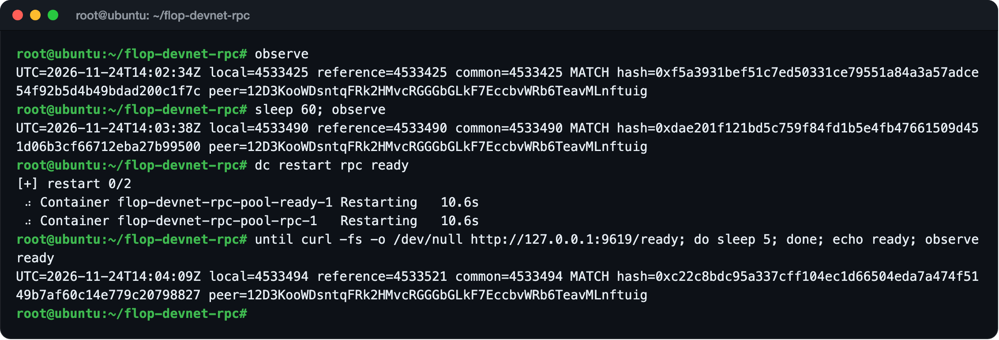

---

## 12. Yedekleme

Düğümün kimliği tek bir dosyada. Kendi bilgisayarınızda bir terminal açıp çekin:

```bash
mkdir -p ~/flop-validator-yedek
scp root@SUNUCU_IP:/var/lib/docker/volumes/flop-devnet-rpc-pool_rpc-data/_data/node_key.dat ~/flop-validator-yedek/
scp root@SUNUCU_IP:flop-devnet-rpc/rpc-pool.env ~/flop-validator-yedek/
```

- Başka sunucuya geçerken 2-7. adımları yapın, `node_key.dat` dosyasını yeni sunucunun ana
  klasörüne kopyalayın ve 8. adım yerine şunu çalıştırın; peer ID aynı kalır:

```bash
dc() { docker compose --env-file ~/flop-devnet-rpc/rpc-pool.env -f ~/flop-devnet-rpc/docker-compose.rpc.yml "$@"; }
dc up -d && sleep 10 && dc stop
V=$(docker volume inspect -f '{{.Mountpoint}}' flop-devnet-rpc-pool_rpc-data)
install -o "$(stat -c %u $V/node_key.dat)" -g "$(stat -c %g $V/node_key.dat)" -m 644 ~/node_key.dat $V/node_key.dat
dc up -d
```

- `node_key.dat` dosyasını kimseyle paylaşmayın.

---

Hazırlayan: [@UfukDegen](https://x.com/UfukDegen)
